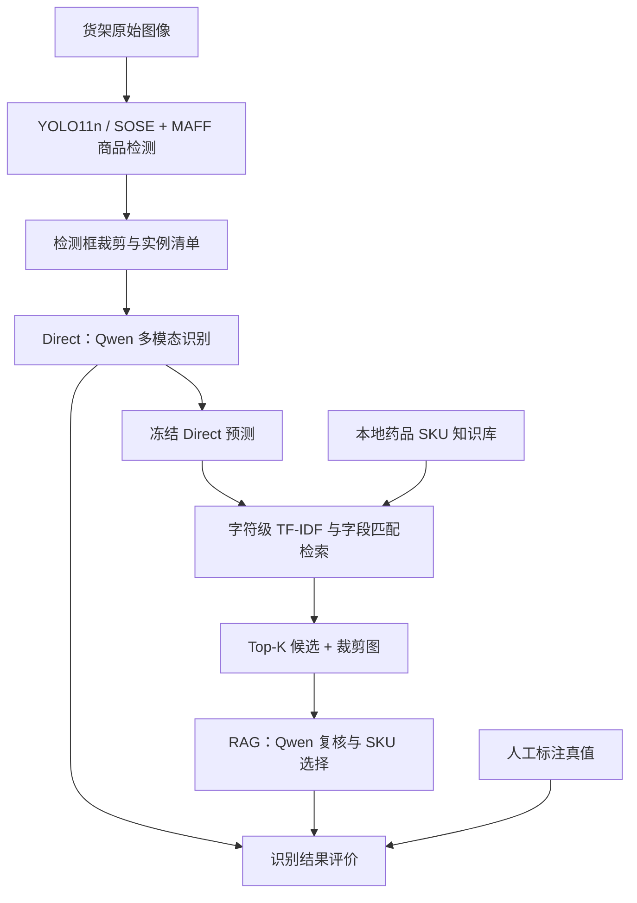

# PharmaShelf-AI

**面向药店货架场景的密集商品检测与药品 SKU 识别实验项目。**

本项目基于 Ultralytics 源码，围绕货架中的小目标、密集排列与包装文字识别开展实验：使用 YOLO11n 及 SOSE、MAFF 改进结构定位商品，将检测框裁剪为实例图像，再对比 Qwen 多模态直接识别和知识库增强识别（RAG）的效果。

仓库包含模型实现、训练与评价脚本、实例裁剪工具，以及 Direct / RAG 对照实验流程。数据集、训练权重、药品知识库和运行结果需自行准备。

## 工作流程



检测阶段定位商品框；名称、规格、厂家和 SKU 等细粒度属性由后续识别流程处理。当前实现以独立实验脚本为主，各阶段通过文件衔接。

## 核心内容

| 模块 | 实现与用途 |
| --- | --- |
| 小目标特征增强 SOSE | 融合 P2/4 浅层细节与 P3/8 特征，结合局部增强、通道与空间注意力，输出增强后的 P3 特征 |
| 多尺度特征融合 MAFF | 对齐 P3、P4、P5 特征，进行可学习加权与空间融合，在检测头前输出三个尺度的特征 |
| 检测实验 | 包含单模块消融、组合结构、SKU-110K 预训练、MRS 迁移微调、多随机种子和五折交叉验证脚本 |
| 实例准备 | 根据预测框裁剪原始图像，生成实例清单，辅助人工标注和知识库字段补全 |
| Direct 基线 | 仅向 Qwen 提供裁剪图，输出结构化商品信息；严格 SKU 在评价阶段离线映射 |
| RAG 实验 | 复用冻结的 Direct 结果检索候选，再结合图像复核；选中 SKU 后由程序从知识库回填规范字段 |

SOSE、MAFF 实现在 [`ultralytics/nn/modules/block.py`](ultralytics/nn/modules/block.py)，模型解析逻辑位于 [`ultralytics/nn/tasks.py`](ultralytics/nn/tasks.py)。

### 模型配置

| 配置文件 | 结构 |
| --- | --- |
| [`yolo11n-sose.yaml`](yolo11n-sose.yaml) | YOLO11n + SOSE |
| [`yolo11n-maff.yaml`](yolo11n-maff.yaml) | YOLO11n + MAFF |
| [`yolo11n-sose-maff.yaml`](yolo11n-sose-maff.yaml) | YOLO11n + SOSE + MAFF |
| [`yolo11n-msa.yaml`](yolo11n-msa.yaml) | MSA 实验所用的 SOSE + MAFF 组合配置 |

各 YAML 中的通道设置以文件内容为准；训练时类别数由数据集配置覆盖。

## 项目结构

```text
PharmaShelf-AI/
├── ultralytics/                         # 基础框架与自定义网络模块
├── yolo11n-*.yaml                       # 改进模型配置
├── MRSDataset.yaml                     # MRS 药店货架数据配置
├── SKU110K_fixed.yaml                   # SKU-110K 数据配置
├── train_*.py                          # 训练、消融与迁移实验
├── mrs_5fold_cv_yolo11n_vs_msa_final.py  # 五折交叉验证
├── predict_msa_yolo11_mrs_best.py        # 检测预测
├── crop_yolo_predict_to_sku_instances.py # 实例裁剪与清单生成
├── enrich_gt_fields_from_kb_fixed.py    # 真值字段补全与审计
├── qwen37plus_direct_experiment/        # Direct 准备、推理和评价
├── qwen37plus_rag_experiment/           # RAG 准备、检索、推理和评价
├── rag_knowledge_base/                 # 本地知识库放置说明
├── compare_mrs_models.py                # 检测模型比较
├── plot_map_curves.py                   # mAP 曲线绘制
├── plot_topk_recall.py                  # 检索召回曲线绘制
├── pyproject.toml                      # Python 包与依赖配置
└── LICENSE                            # AGPL-3.0 许可证
```

`docs/`、`examples/`、`docker/` 和 `tests/` 中还保留了基础框架的文档、示例与工具。

## 安装

在项目根目录执行：

```bash
git clone https://github.com/pzx797/PharmaShelf-AI.git
cd PharmaShelf-AI
python -m venv .venv
```

激活虚拟环境，Windows PowerShell：

```powershell
.\.venv\Scripts\Activate.ps1
```

Linux / macOS：

```bash
source .venv/bin/activate
```

安装本仓库及识别实验依赖：

```bash
python -m pip install -e .
python -m pip install -r qwen37plus_rag_experiment/requirements.txt
```

请使用本仓库的可编辑安装，以加载自定义 SOSE、MAFF 模块。基础包声明 Python >= 3.8，完整实验环境还需满足实际安装的依赖版本要求。检测训练脚本默认使用 GPU，运行前需确认 PyTorch 与本机 CUDA 环境匹配。

## 数据与路径准备

### 检测数据

准备 YOLO 检测格式的数据目录，并修改 `MRSDataset.yaml` 或 `SKU110K_fixed.yaml` 中的 `path`：

```text
datasets/MRSDataset/
├── images/
│   ├── train/
│   ├── val/
│   └── test/
└── labels/
    ├── train/
    ├── val/
    └── test/
```

每张图像对应同名 `.txt` 标签，格式为 `class x_center y_center width height`，坐标归一化。当前 MRS 配置采用单类 `drug`，SKU-110K 的具体类别命名以所选 YAML 为准。

### 识别数据

Direct / RAG 实验需要：

- 检测后生成的商品裁剪图。
- 人工标注的实例级真值表，使用 `crop_path` 对齐图像，并提供评价所需的 SKU、名称、规格、厂家等字段。
- 药品知识库 `rag_knowledge_base/sku_kb_cleaned.xlsx`。

知识库索引脚本检查以下列是否存在：

```text
sku_id, drug_name, generic_name, raw_product_name, manufacturer,
raw_specification, specification, category, aliases,
visual_keywords, text_for_embedding
```

字段处理规则见 [`02_build_rag_index.py`](qwen37plus_rag_experiment/02_build_rag_index.py)，真值字段映射见 [`01_prepare_direct_experiment.py`](qwen37plus_direct_experiment/01_prepare_direct_experiment.py)。

**运行前需要修改路径。** 当前脚本中保留了原实验的 Windows 和 Linux 绝对路径。请检查训练脚本中的数据、权重、输出目录，裁剪脚本中的原图与预测目录，以及 Direct / RAG 脚本中的 `CROP_DIR`、`GT_PATH`、`KB_PATH`、`OUTPUT_ROOT`、默认配置路径等。Direct 准备脚本的知识库默认路径与 RAG 目录不同，应统一指向自己准备的知识库。

## 检测实验

以下命令均在项目根目录执行。开始训练前，先修改相应脚本的预训练权重路径、输出路径、GPU、batch 和训练参数。

```bash
# 在 SKU-110K 上训练组合模型
python train_mas_sku_pretrained.py

# 使用 SKU 预训练权重，在 MRS 上进行五随机种子微调与测试
python train_msa_yolo11n_sku_to_mrs_5seeds.py

# SOSE / MAFF 消融与组合训练
python train_yolo11n_sose.py
python train_yolo11n_maff.py
python train_yolo11n_mas_mrs.py

# YOLO11n 与 MSA 的五折交叉验证
python mrs_5fold_cv_yolo11n_vs_msa_final.py
```

上述命令对应不同实验方案，按所需方案选择执行。五随机种子迁移脚本使用种子 `0–4`，设置 50 轮第一阶段和 250 轮第二阶段训练，汇总测试结果的均值与标准差。

完成训练后，配置预测与裁剪路径，再执行：

```bash
python predict_msa_yolo11_mrs_best.py
python crop_yolo_predict_to_sku_instances.py
```

裁剪脚本默认保留置信度不低于 `0.25` 的预测框，并增加 `5%` 边界 padding，输出 `crops/`、`instances.csv` 和 `skipped_predictions.csv`。请使用未绘制检测框的原始图像进行裁剪。人工确认实例标注后，可使用 `enrich_gt_fields_from_kb_fixed.py` 补全知识库字段，该工具输出新的真值表与审计信息。

## Direct / RAG 识别实验

### API 配置

推理脚本通过环境变量 `DASHSCOPE_API_KEY` 读取密钥，使用 DashScope 的 OpenAI 兼容接口。PowerShell 中设置：

```powershell
$env:DASHSCOPE_API_KEY="你的API-Key"
```

Linux / macOS：

```bash
export DASHSCOPE_API_KEY="你的API-Key"
```

代码当前配置的模型标识为 `qwen3.7-plus-2026-05-26`。运行前确认账号可访问该模型，必要时在准备脚本中修改模型标识；对照实验需保持两组模型与推理参数一致。推理会调用外部 API 并产生相应费用。

### 1. 建立 Direct 基线

准备好裁剪图、真值表和知识库，并修改脚本路径后，从项目根目录执行：

```bash
python qwen37plus_direct_experiment/01_prepare_direct_experiment.py
python qwen37plus_direct_experiment/02_run_qwen37plus_direct.py --limit 3
```

检查试跑输出后，完成全量推理与评价：

```bash
python qwen37plus_direct_experiment/02_run_qwen37plus_direct.py
python qwen37plus_direct_experiment/03_evaluate_direct_results.py
```

准备阶段生成输入清单、配置和冻结提示词。Direct 推理只依据图像识别，知识库用于后续离线评价映射，不作为候选传给模型。

### 2. 运行 RAG 实验

完成 Direct 基线后，检查 RAG 脚本中基线结果、知识库和输出路径：

```bash
python qwen37plus_rag_experiment/01_prepare_rag_experiment.py
python qwen37plus_rag_experiment/02_build_rag_index.py
python qwen37plus_rag_experiment/03_run_qwen37plus_rag.py --limit 3
```

确认检索候选、SKU 选择和图像证据合理后，执行全量推理与评价：

```bash
python qwen37plus_rag_experiment/03_run_qwen37plus_rag.py
python qwen37plus_rag_experiment/04_evaluate_rag_results.py
python qwen37plus_rag_experiment/05_evaluate_retrieval_results.py
```

RAG 默认检索 Top-5 候选，采用字符级 TF-IDF 与字段匹配加权。模型只能从候选中选择 SKU，程序随后回填知识库规范字段；人工真值不参与检索与模型复核。推理脚本支持断点续跑，具体状态处理规则见[实验说明](qwen37plus_rag_experiment/README.md)。

结果写入各实验目录下的 `runs/`：Direct 默认为 `qwen37plus_direct_v1`，RAG 默认为 `qwen37plus_rag_v1`。RAG 输出包括配置、输入清单、提示词、索引、检索候选、原始响应、预测、评价和日志。

## 评价与结果边界

| 阶段 | 评价内容 |
| --- | --- |
| 商品检测 | Precision、Recall、mAP50、mAP50-95，以及多种子或交叉验证统计 |
| 商品识别 | 名称、规格、厂家、严格 SKU、拒识与错误确定识别情况 |
| 知识库检索 | Top-1 / Top-3 / Top-5 召回率、MRR |
| 候选选择 | SKU 选择覆盖率、最终选择准确率、真值已召回条件下的重排准确率 |
| 推理开销 | 延迟和 Token 使用情况 |

仓库中的[离线检索预检记录](qwen37plus_rag_experiment/OFFLINE_VALIDATION.md)报告：在 340 个具有真值 SKU 的实例上，Top-1、Top-3、Top-5 候选召回率分别为 **60.88%、78.53%、86.18%**。这些数值来自已有实验记录，本 README 更新未重新运行实验。

**候选召回率不等于最终 SKU 识别准确率。** 该预检只运行检索，未调用 Qwen API。检测性能与最终 RAG 识别性能应以对应实验实际生成的评价报告为准。

当前 RAG 相比单次 Direct 同时增加了知识库候选和第二次模型复核。若要单独衡量知识库的贡献，需要增加不提供知识库候选的二次复核对照组。

## 仓库内容与复现范围

`.gitignore` 已排除数据集、模型权重、训练与识别运行目录、密钥环境文件和本地知识库表格。克隆代码后，需要自行补齐这些资源，修改路径并生成中间结果，才能运行完整流程。

分享实验结果时，请同时记录模型配置、数据划分、预训练来源、随机种子、推理参数和评价口径。知识库内容与原始图像是否公开，应依据各自的数据来源与授权确定。

## 基础框架与许可证

本项目基于 [Ultralytics](https://github.com/ultralytics/ultralytics) 进行修改，保留基础框架的版权与许可证信息。仓库采用 **AGPL-3.0**，详见 [LICENSE](LICENSE)。
